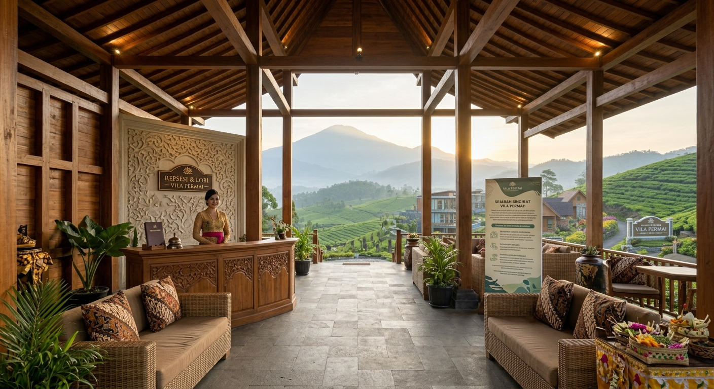

# 🌿 Website Reservasi Vila Permai - Puncak, Bogor

> Proyek pembuatan website latihan pemesanan vila bertema wisata alam Puncak, Bogor yang dibangun menggunakan HTML5, CSS3, dan Vanilla JavaScript tanpa back-end atau database server.

---

## Informasi Mahasiswa
Nama Mahasiswa: Muhamad Isro
NPM / NIM:  24011130445
Kelas: MI5BM
Nama Repository: `uts-villa-permai-24011130445`

---

## Deskripsi Singkat & Fitur
Website ini dirancang untuk memudahkan calon pengunjung dalam melihat fasilitas serta melakukan reservasi unit vila secara interaktif melalui peramban (browser). 

## Daftar Fitur yang Sudah Selesai (100% Implemented):
1. Navigasi & Hero Section: Tampilan header responsif dan landing page bertema alam Puncak.
2. Tentang Vila: Informasi latar belakang penginapan.
3. Section Fasilitas Resort (Image Overlay): Tampilan galeri fasilitas interaktif (*Infinity Pool*, *Private Dining*, dan *Tour Services*) menggunakan kartu gambar aset lokal.
4. **Katalog Unit Vila Dinamis:** Rendering daftar unit vila secara otomatis menggunakan data objek array JavaScript.
5. **Kalkulator Biaya Real-Time:** Menghitung total biaya otomatis berdasarkan pilihan unit, durasi malam, dan jumlah tamu.
6. **Formulir Reservasi & Validasi Input:** Validasi nama, tanggal check-in/out, dan jumlah tamu secara terintegrasi.
7. **Penyimpanan Lokal (localStorage):** Menyimpan ringkasan data pemesanan tamu ke dalam penyimpanan browser client-side.
8. **Layout Responsif:** Tampilan yang menyesuaikan dengan baik di perangkat desktop maupun seluler.

## Daftar Fitur yang Belum Selesai / Dibatalkan:
* **Fitur Pencarian Vila (Search Bar):** Fitur pencarian unit vila dibatalkan/dihapus sesuai spesifikasi permintaan terbaru.
* **Integrasi Database & Back-End Server:** Memang tidak dibuat karena sistem dirancang pure client-side murni.

---

## Tangkapan Layar (Screenshot Halaman Web)

*(Catatan: Anda juga dapat mengganti tautan gambar di atas dengan file screenshot hasil tampilan browser Anda yang disimpan di folder `assets/images/screenshot.png`).*

---

## Cara Menjalankan Halaman Web
Karena proyek ini berbasis *client-side* murni (tanpa database server):

1. Unduh (*clone* atau *download ZIP*) repository ini ke komputer Anda.
2. Jika menggunakan **XAMPP**, ekstrak/taruh folder proyek di direktori `C:\xampp\htdocs\uts-villa-permai\`.
3. Buka peramban web (Google Chrome, Edge, atau Firefox).
4. Jalankan proyek dengan salah satu cara berikut:
   * **Cara 1 (Langsung):** Klik dua kali (*double click*) pada file **`index.html`** di dalam folder proyek.
   * **Cara 2 (Via Localhost XAMPP):** Ketik URL `http://localhost/uts-villa-permai/index.html` pada bilah alamat peramban Anda.

---

## Hak Cipta & Lisensi
Hak Cipta &copy; 2026 Muhamad Isro - Vila Permai. All Rights Reserved.